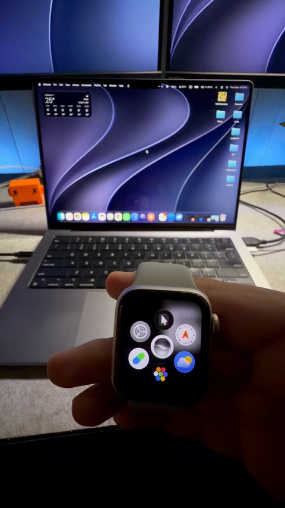

# WatchPointer


WatchPointer turns your Apple Watch into a Bluetooth remote for your Mac. Point at the screen to move the cursor, tap to click, or swipe to switch tabs and workspaces.

The watch talks directly to your Mac over Bluetooth. WatchPointer runs without a server.

**1.2.0 source preview.** The Mac build and Chrome tab switching have been tested. Two-finger gestures and Mission Control window selection still need a physical Series 11 check on this version.

<p align="center">
  
</p>

## What it does

- **Point** like a laser pointer: the cursor goes where the top edge of the watch points. Works across all your displays.
- **Tap** the pad to click, **hold** to drag, **right-click** button, **Digital Crown** to scroll.
- **Center** re-aims the middle of the screen; **Pause** frees the cursor for your trackpad.
- **Swipe** on the watch pad to switch browser tabs or macOS Spaces, or to open Mission Control.
- **Dictate** on the watch, review the draft, and send it to a focused text field on the Mac.
- **Pair** with a Mac once; the watch only connects to that Mac until you unpair it.
- **Menu bar** on the Mac: check the connection, open permission settings, and quit WatchPointer.
- **Notch panel** on the Mac: connection state, the watch's name and model, battery, live aim, and a pin to keep it open.
- **Sky Shot**, a small light-gun style game to try it on.

## Requirements

- Mac with macOS 14 or later and Bluetooth
- Apple Watch with watchOS 11 or later
- Xcode 16 or later to build, sign, and install the watch app
- Xcode Command Line Tools or full Xcode to build the Mac app

## Build and run

GitHub releases provide the source. Build both apps with your own signing settings for the watch.

```bash
git clone https://github.com/cndfdv/WatchPointer.git
cd WatchPointer
```

### 1. Mac app

Run this from the project folder to build `Mac/.build/app/WatchPointer.app` for local use:

```bash
Mac/build-app.sh
```

Open **WatchPointer.app** in Finder. The watch icon in the menu bar shows the receiver's status. Choose **Quit WatchPointer** from that menu to stop the receiver.

The first time, allow **Bluetooth** when macOS asks. Use **Open Accessibility Settings** in the menu and enable **WatchPointer** so it can move the cursor. If macOS asks you to reopen the app, quit it from the menu and open it again in Finder.

#### Command-line alternative

```bash
cd Mac
swift run WatchPointer
```

For this launch method, macOS requests permissions for your terminal app. Allow **Bluetooth** and **Accessibility** for it. Run one receiver at a time.

### 2. Watch app

1. Open `Watch/WatchPointer.xcodeproj` in Xcode.
2. In **Signing & Capabilities**, enable automatic signing, select your Apple development team, and use a unique bundle identifier.
3. Choose your Apple Watch as the run destination and press **⌘R**.
4. Open WatchPointer on the watch and tap **Pair** next to your Mac.

### 3. Point

Hold the watch like a remote with the top edge (12 o'clock) toward the screen. Point at the middle of the screen and tap **Center** to line it up.

### 4. Swipe and dictate

Update both apps. In the Mac menu, choose **Pair Watch Input…**. On the watch, open **Remote actions** using the ellipsis button, choose **Pair Watch Input**, and enter the six-digit code shown on the Mac. If macOS or watchOS asks to confirm Bluetooth pairing, follow the system prompt. To revoke this permission, choose **Forget Watch Input** on the Mac.

The standard build checks the encrypted Bluetooth link before sending a swipe or dictation command for the first time on a connection. If the watch reports a Bluetooth pairing problem while the pointer still moves, open **Pair Watch Input** and confirm any system Bluetooth prompt before retrying.

- Swipe **left with one finger** for the next tab or **right** for the previous tab in a supported browser, such as Chrome or Safari.
- Swipe **left with two fingers** for the next Space or **right** for the previous Space. Spaces include desktops and full-screen windows.
- Swipe **up with two fingers** to open Mission Control. Point at a window and tap the pad to select it. If a two-finger swipe switches a browser tab instead, place both fingertips on the pad before moving them together.
- In **Remote actions**, choose **Dictate** and use the microphone on the system text-entry screen. Review the draft, click an editable text field on your Mac, and choose **Send** on the watch. Long drafts can be sent in shorter parts. WatchPointer sends the approved text over Bluetooth. System dictation follows the watch's language and dictation settings.

#### Local builds for Bluetooth pairing problems

If macOS and watchOS cannot complete system pairing for protected commands, you can build a matched pair with an app-level key. Create `.local/watch-signing.xcconfig` with your own team ID and bundle identifier:

```xcconfig
DEVELOPMENT_TEAM = YOUR_TEAM_ID
PRODUCT_BUNDLE_IDENTIFIER = com.example.watchpointer
```

With your Apple Development signing identity available in Xcode, run `./build-local-input.sh .local/my-pair`. Install both signed apps from that output and use **Pair Watch Input** to authorize the watch. The two apps contain the same private key, so keep the output and the key in your local checkout.

## Settings

The Finder app uses the defaults. To try different values, quit it and run the receiver from `Mac/` with command-line options:

```bash
swift run WatchPointer 1.2               # speed: higher = less turn to reach the edges
swift run WatchPointer steady=0.6        # steadier when holding still (default 0.8)
swift run WatchPointer quick=0.02        # less lag on fast moves (default 0.01)
```

## Sky Shot

Open `Game/index.html` in a browser, press **F** for full screen, and tap the watch to start. Paper planes fly across a sky that turns from morning to sunset as the round runs out. Bullseyes count double, gold planes triple.

## Tips for using it in your hand

Keep the watch unlocked during use. To keep WatchPointer visible for longer, adjust **Display & Brightness › Wake Duration** and **General › Return to Clock › WatchPointer** on the watch.

## How it works

- **Watch** (`Watch/`): reads gravity and the gyroscope 100 times a second. Up/down comes from gravity, so it never drifts; left/right adds up turns around the vertical. Each sample is sent with the watch's timestamp.
- **Mac** (`Mac/`): projects the aim onto the screen like a laser hitting a wall, smooths it with a [1€ filter](https://gery.casiez.net/1euro/) using the watch's timestamps, and moves the cursor 240 times a second on its own thread. Clicks land where you were pointing the moment your thumb touched the watch, so the tap's jolt doesn't move them.
- **Bluetooth**: the Mac advertises a service; the watch connects and writes small packets (aim, click, drag, scroll, pause, info). The protocol is documented at the top of `Mac/Sources/WatchPointer/Receiver.swift`.

## Security note

Pointer pairing is chosen on the watch. A nearby Bluetooth device that speaks the pointer protocol could move the cursor while the receiver is running. Quit the receiver when you're not using it. The standard build protects swipes and dictation with Bluetooth encryption. Matching local builds use authenticated encryption in the app. Both require approval with the Mac's pairing code before accepting swipes or dictation.

## Contributing

See [CONTRIBUTING.md](CONTRIBUTING.md) for checks and bug reports. Report security issues privately using [SECURITY.md](SECURITY.md).

## License

WatchPointer is available under the [MIT License](LICENSE). The original pointer project was created by Umar Afzal. [Original WatchPointer](https://github.com/umarz317/WatchPointer)
